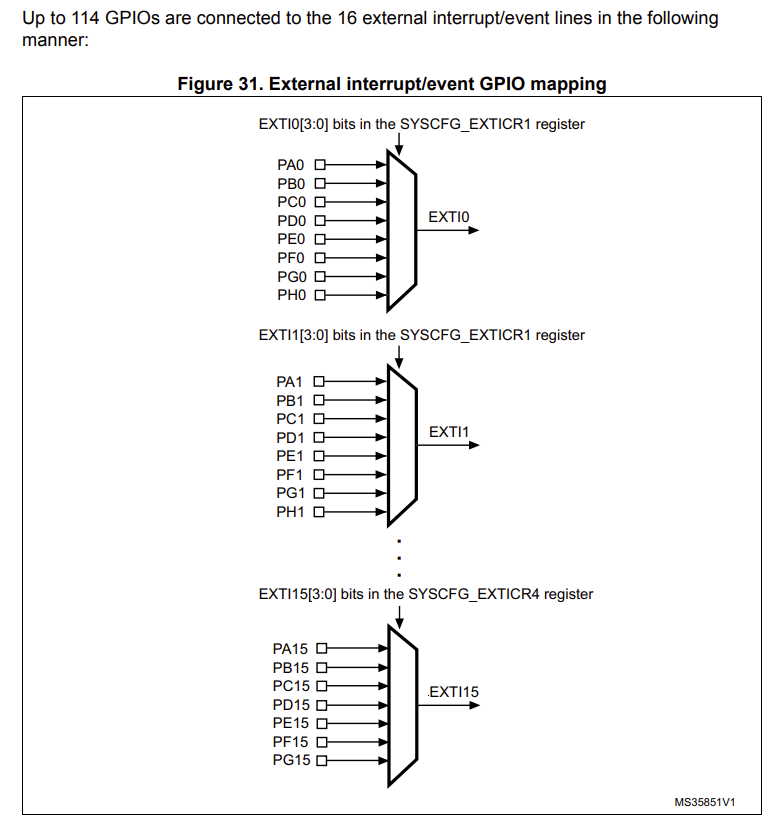
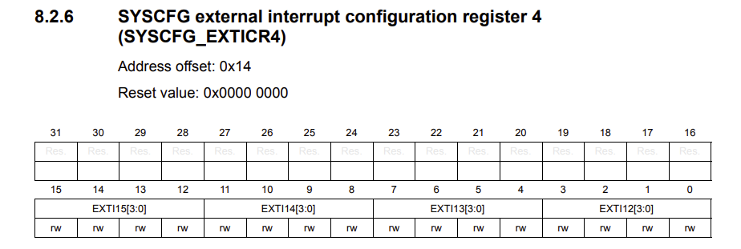
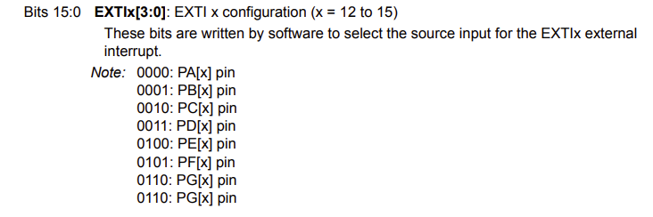

# STM32 Interrupt Driven Button

# Project Setup 

The goal is to setup an interrupt on the push-button to toggle the LED. 

## Interrupts Background
An interrupt is a hardware or software signal that temporarily pauses normal CPU execution to handle an event requiring immediate attention. . With interrupts, the processor can execute other instructions or enter a low-power state until an event occurs. Interrupts allow an MCU to respond to events without continuously monitoring them.

## Interrupt Register Configuration

First the APB2 clock enable register bit 14 needs to be ON, to enable the System Configuration Controller (SYSCFG) peripheral clock. SYSCFG controls the routing of GPIO pins to EXTI lines. Enabling its clock allows you to configure registers such as SYSCFG_EXTICR4.
```
RCC->APB2ENR |= (1U << 14); 
```
We are configuring a hardware driven interrupt. Since the push-buttom is connected to GPIO pin PC13, EXTI13 is used to connect the pin to the external interrupt event line.  



EXTI13 is configured by bits 4 to 7 in the SYSCFG_EXTICR4 register. The source input for the interupt can be set by the number stored in the three bits as shown below. 



Since PC13 is the source, 0010 must be set in the register.


```
SYSCFG->EXTICR[3] &= ~(0xFU << 4);  // Clear EXTI13 field
SYSCFG->EXTICR[3] |=  (0x2U << 4);  // Select GPIOC
```

Since PC13 will be connected to EXTI line 13, the appropriate EXTI registers need to be configured. 

- EXTI_IMR: Interrupt mask register
    - Controls whether an EXTI line is allowed to generate an interrupt request to the NVIC
- EXTI_RTSR: Rising edge trigger selection register  
    - Selects whether EXTI detects a rising edge on an input signal
- EXTI_FTSR: Falling edge trigger selection register
    - Selects whether EXTI detects a falling edge on an input signal
- EXTI_PR: Pending register
    - Indicates whether an interrupt event has been detected on an EXTI line

The block below disables rising edge trigger, enables falling edge trigger, clears any pending interrupts and enables interrupt requests to NVIC for EXTI13. NVIC_EnableIRQ(EXTI15_10_IRQn) enables the EXTI15_10 interrupt in the Nested Vectored Interrupt Controller (NVIC), allowing the CPU to receive interrupt requests from EXTI lines 10–15.
```
EXTI->RTSR &= ~(1U << 13);
EXTI->FTSR |=  (1U << 13);
EXTI->PR = (1U << 13);
EXTI->IMR |= (1U << 13);
NVIC_EnableIRQ(EXTI15_10_IRQn);
```
### Interrupt Service Routine

The interrupt service routine clears the pending interrupts register and toggles the LED if a bit is registered in the pending interrupts register. 

```
void EXTI15_10_IRQHandler(void)
{
    if (EXTI->PR & (1U << 13))
    {
        // Clear pending interrupt flag
        EXTI->PR = (1U << 13);
        GPIOA->ODR ^= (1U << 5);
    }
}
```
# Code

The main loop runs the intilzation function and does nothing, this will be interupted by the ISR defined in the function above. 

```
int main(void)
{
    GPIO_Init();
    while (1)
    {
        // Main program continues running
    }
}
```