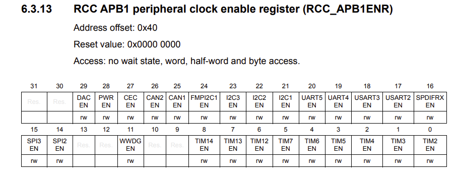
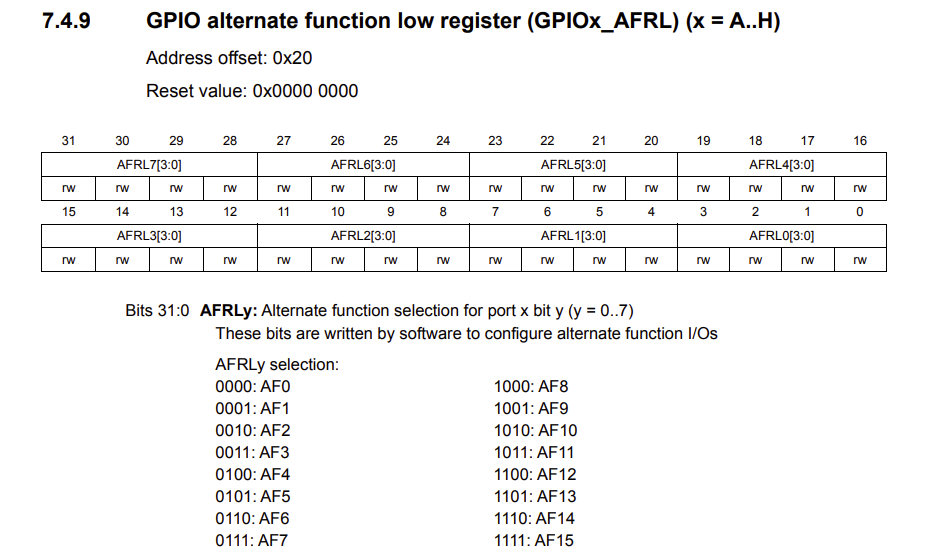
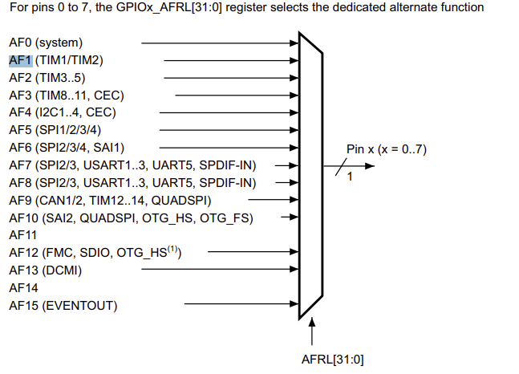

# STM32 Hardware PWM LED Dimmer

# Project Setup 

The goal is to control the brightness of the onboard LED with PWM signals.

## PWM Signals Background


Pulse width modulation mode allows to generate a signal with a frequency determined by the value of the TIMx_ARR register and a duty cycle determined by the value of the
TIMx_CCRx register.

## Configuration

First, Timer 2 needs to be enabled. This can be done with the with the first bit in the APB1 peripheral clock enable register. 

```
	RCC->APB1ENR |= RCC_APB1ENR_TIM2EN;
```

The appropriate TIM2 registers need to be configured. 

- CCR1: Capture/Compare Register 1
    - Stores the compare value used by Timer Channel 1. In PWM mode, CCR1 determines the duty cycle by defining the counter value at which the timer output changes state. The output switches from HIGH to LOW, when CCR1 is reached in PWM mode 1
- CCMR1: Capture/Compare Mode Register 1  
    - CCMR1 determines how the timer channel operates. It configures the channel as output compare. PWM Mode 1 generates an active output while CNT is less than CCR1 (when counting up)
- CCER: Falling edge trigger selection register
    - Setting CC1E enables the PWM output to be driven onto the configured GPIO alternate-function pin, provided the timer is running and the other configurations are correct. This enables TIM2 Channel 1 output on PA5
- CR1: Control Register 1
    - Bit 0: Enables/Disables counter (1/0)
    - Bit 7: Enables Auto-reload preload, when disabled writing a new value to ARR immediately updates the active auto-reload value and affect the current timer period.
- EGR: Event Generation Register
    - This manually generates an update event, which causes the timer to reload the prescaler from its preload register, reset counter, update-timer events and load preload values into registers
- ARR: Auto-Reload Register 
    - Determines the maximum value of the counter

```
	TIM2->CCR1 = 100;
	TIM2->CCMR1 &= ~(7U << 4);
	TIM2->CCMR1 |=  (6U << 4);
	TIM2->CCMR1 |= (1U << 3);
	TIM2->CCER |= (1U << 0);
	TIM2->CR1 |= (1U << 7);
	TIM2->PSC = 15;
	TIM2->ARR = 999;
	TIM2->EGR |= (1U << 0);
	TIM2->CR1 |= (1U << 0);
```
LED configuration is the same as what has been configured in previous steps. There are however some minor changes. Rather than being configured as an output, the LED is now configured for alternative function based on the GPIOA_MODER register. Additionally, GPIOA_AFR[0] is the Alternate Function Register Low that configures pins PA0–PA7. The first line clears any alternate function while the second line sets PA5 to use alternative function 1.

<p align="center">
    
  
</p>

```
	/*LED*/
	GPIOA->MODER &= ~(3U << (5 * 2));
	GPIOA->MODER |=  (2U << (5 * 2));
	GPIOA->OTYPER &= ~(1U << 5);
	GPIOA->OSPEEDR &= ~(3U << (5 * 2));
	GPIOA->PUPDR &= ~(3U << (5 * 2));
	GPIOA->AFR[0] &= ~(0xFU << (5 * 4));
	GPIOA->AFR[0] |=  (1U << (5 * 4));
```

# Code
The main loop runs the intilzation function and then increases the brightness to the maximum. Then it gradually lower the brightness to the minimum level and repeats.  

```
int main(void){
	init();
	while(1){
		for(int i=0;i<20;i++){
			if(i<=10){
				TIM2->CCR1 = (i*10);
				delay(100000);
			}else{
				TIM2->CCR1 = (20-i)*10;
				delay(100000);
			}
		}
	}
};
```