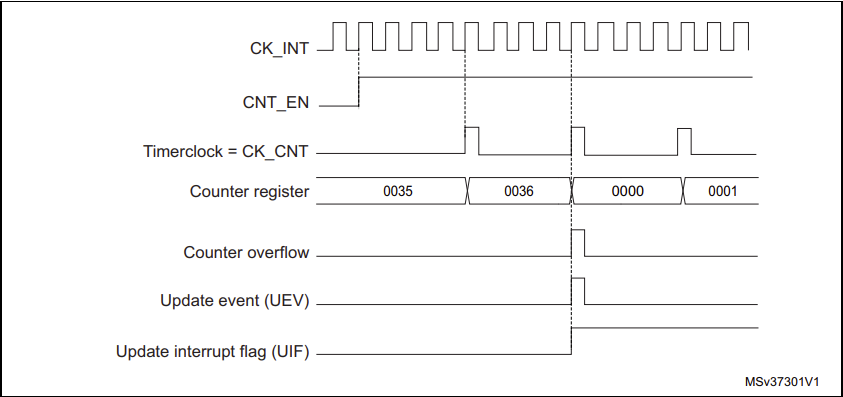
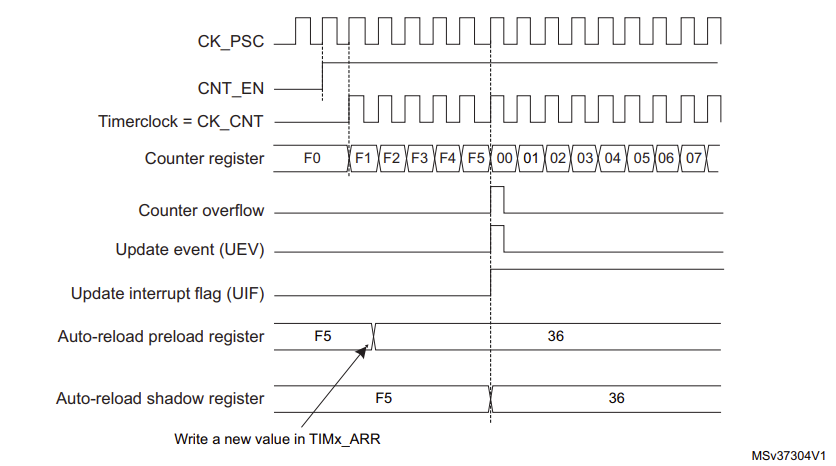
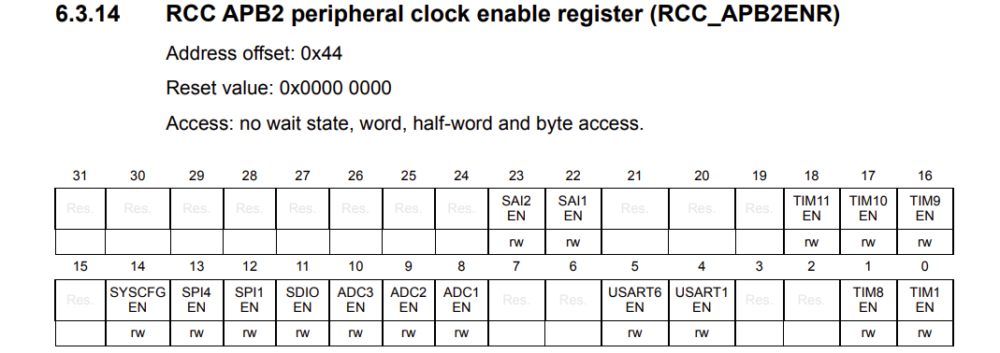

# STM32 GPIO LED With Button Input

# Project Setup 
First an STM32 project was created. Missing include files were added from the following filepaths:
"STM32Cube\Repository\STM32Cube_FW_F4_V1.27.0\Drivers\CMSIS\Device\ST\STM32F4xx\Include" "STM32Cube\Repository\STM32Cube_FW_F4_V1.27.0\Drivers\CMSIS\Include" 

Including these file path in the project lets us use the hardware specific header file that contains all the register adresses.

The goal is to setup a button to toggle an LED, which implements counters for debouncing the push-button. 

## Counters Background
A prescaler is an electronic counting circuit that divides a high-frequency input clock signal by a programmable factor before passing it to another circuit. This reduces the clock frequency, allowing timers and counters to operate at slower, more manageable speeds. In the STM32, the prescaler can divide the timer input clock by a factor ranging from 1 to 65,536. It is implemented using a 16-bit counter controlled by the 16-bit TIMx_PSC register. The counter is clocked by the prescaler output, CK_CNT, which is enabled when the Counter Enable (CEN) bit in the TIMx_CR1 register is set. In upcounting mode, the timer counter increments from 0 until it reaches the auto-reload value stored in the TIMx_ARR register, at which point it generates an update event and begins counting again.




In edge-aligned (sawtooth) mode, the timer counter continuously increments from 0 to the auto-reload value (ARR). Once it reaches ARR, it generates an overflow event, resets to 0, and begins counting upward again. In contrast, center-aligned (triangular) mode alternates between upcounting and downcounting. The counter increments from 0 to ARR, generates an overflow event, and then reverses direction, counting down to 0 before generating an underflow event and repeating the cycle. This produces a triangular counting waveform rather than the sawtooth waveform of edge-aligned mode.

To use timers, the click for the associated timer must be enabled. Depending on the timer selected, the associated bit in the register must be turned on.

```
RCC->APB2ENR |= RCC_APB2ENR_TIM1EN;

```
## TIM1 Register Configuration

### Control Register
- bit 0 is used to enable the counter
- bit 1 configures the counter to generate an overflow/underflow event
- bit 4 congifures the counter as an up/down counter
- bit 7 enables autoreload of the TIM_ARR register

### Status Register
- bit 1 is updated by the software at overflow or underflow

### Auto Reload Register
- The auto reload register is a 16-bit register that contains the value at which the counter counts up to. in this implementation it is set to 0

### Prescaler
- The prescaler is loaded with the value 15999. This scales the APB2 Clk by 15999, to scale the clk from 16Mhz to 1Khz accounting for the counter initilizing at 0.

### DMA/Interrupt Enable Register
- This register determines with events can trigger interrupts. bit 0 enables interrupts when the auto-reload value is reached. Additionally, the next line allows the processor to receive and respond to interrupt requests from the TIM1 update event.

```
			TIM1->CR1 &= ~(1U << 0);
			TIM1->CR1 |= (0U << 1);
			TIM1->CR1 &= ~(1U << 3);
			TIM1->CR1 &= ~(1U << 4);
			TIM1->CR1 |= (1U << 7);
			TIM1->CR1 = (1U << 0);
			TIM1->SR = ~(1U << 0);
			TIM1->PSC = 15999;
			TIM1->ARR = 0;
			TIM1->DIER |= (1U << 0);
			NVIC_EnableIRQ(TIM1_UP_TIM10_IRQn);
			TIM1->CR1 |= (1U << 0);

```

# Code

Building on the push-button triggered LED, a toggle is added by introducing a previous and current button state. Comparing the current button state to the NOT of the preious state identifies if the push-button state has changed from the previous one. 

NVIC_EnableIRQ is the interrupt service routine that increments the milliseconds counter, as this is triggered by a counter that tirggers every clock pulse with a clock frequency of 1kHz which is 1 ms. The status register also needs to be reset as it will be high once the counter overflows.

```
NVIC_EnableIRQ(TIM1_UP_TIM10_IRQn);

void TIM1_UP_TIM10_IRQHandler(void)
	{
		if (TIM1->SR & (1U << 0))
		{
			TIM1->SR &= ~(1U << 0);
			milliseconds++;
		}
	}

```

The current time in milliseconds is recorded when a button state change is detected. The previous button state is compared with the current state, and if they differ, the time of the state change is stored. The current time is then compared with the timestamp of the previous state change. If the difference exceeds the debounce time and the current button state differs from the previously confirmed button state, the confirmed button state is updated. If the button is pressed, the LED is toggled.

```
    uint32_t previousButtonState = 0;
    uint32_t stableButtonState = 0;
    uint32_t lastTimeChange = 0;
    uint16_t counterFlagMask = (1U << 0);
    uint32_t pinRegMask = (1U << 13);

    while(true){
        uint32_t currentButtonState = GPIOC->IDR & pinRegMask;
        uint32_t currentTime = milliseconds;
        if(currentButtonState && !previousButtonState){
            lastTimeChange = milliseconds;
        }
        if((currentTime - lastTimeChange) >= DEBOUNCE_TIME){
            if(currentButtonState != stableButtonState){
                stableButtonState = currentButtonState;
                if(stableButtonState){
                    GPIOA->ODR ^= (1U << 5);
                }
            }
        }
            previousButtonState = currentButtonState;
    }

```